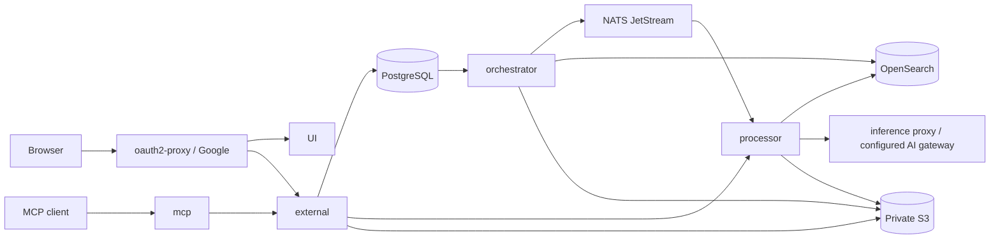

# Architecture

Worldbuilder is the application target in this monorepo. Canon, review, immutable
history and private story persistence use the existing PostgreSQL/CNPG platform.
There is no separate engine repository, Fastify migration or new Cassandra store.
No local Cassandra resources were found; external consumers still require an
inventory and verified export/restore before any separately authorized retirement.

## Services and authority

| Component | Responsibility |
| --- | --- |
| `apps/ui` | React/Vite PWA, shared world workspace, exploration, review, private stories and device-local writing |
| `apps/external` | Public Go HTTP API; authenticated world access, sole canon writer, story/conversation persistence, document proxy and native MCP authorization |
| `apps/mcp` | Go MCP transports, prompts and authorized API delegation; no canon database or publication capability |
| `apps/orchestrator` | Document workflow ownership; transactional canon outbox relay, rebuildable indexing and durable generation dispatch |
| `apps/processor` | TypeScript Node HTTP/LangGraph reasoning and NATS document-processing worker; generates candidates, never approves/publishes |
| `apps/inference` | Opt-in private Go policy proxy for local inference and explicitly selected paid profiles |
| `apps/pkg` | Shared Go modules, including authentication, storage and canon search |

The inference proxy is an opt-in source capability; legacy chat and embedding
routes remain separate compatibility paths. See [inference](inference.md).

## Data boundaries

- PostgreSQL is authoritative for canon, audit, identity, private stories,
  conversations, inference reservations and document lifecycle metadata.
- Published canon changes atomically update projections and append immutable
  revision/audit/outbox rows. Reconciliation and restore create fresh reviewed
  proposals; they never rewrite published history.
- OpenSearch is derived discovery state. Canon results are authorized and resolved
  against PostgreSQL at the requested revision, timeline and fictional time.
- NATS JetStream carries durable work; PostgreSQL outbox/job state remains recovery
  authority beyond broker retention. Uncertain inference is not silently replayed.
- S3 holds raw document bytes and backups. SeaweedFS on private `svartalfheim` is
  the target; retained MinIO remains the source until verified cutover. Browser
  downloads are brokered through authenticated application routes.
- AI outputs, private play and device-local drafts remain provisional. Only the
  server's human governance path can publish canon. Administrators cannot read
  another person's private story or generation job.

## Repository map

| Area | Purpose |
| --- | --- |
| `components/`, `modules/`, `etc/`, `bin/tf` | Terraform composition, reusable modules, layered inputs and wrapper |
| `ansible/` | External host services and worker guest bootstrap |
| `helm/apps`, `helm/bootstrap`, `helm/data`, `helm/infra`, `helm/observability` | Flux-delivered application and platform charts |
| `helm/libraries/commonapi` | Shared app deployment/network/auth templates |
| `sql/` | Explicit schema migrations, grants and operator queries |
| `scripts/`, `evals/`, `.github/` | Operator entry points, disposable acceptance and CI/publication |
| `.devcontainer/` | Local tooling and ignored credential mounts |
| `docs/`, `runbooks/` | Canonical guides and diagnosis |

Terraform manages Proxmox VM lifecycle; Ansible configures external services and
joins workers; Helm/Flux owns Kubernetes workloads. `yggdrasil` is a physical Chromebook
control plane and `midgard` is an intermittent physical GPU worker.

## Product contracts

The [API guide](worldbuilder/api.md) owns domain, governance, temporal and privacy
contracts. [Experience](worldbuilder/experience.md) owns UI/PWA requirements and
journeys. [Status](status.md) owns outstanding work and dated observations.
Retained document capabilities are described in [documents](documents.md).
