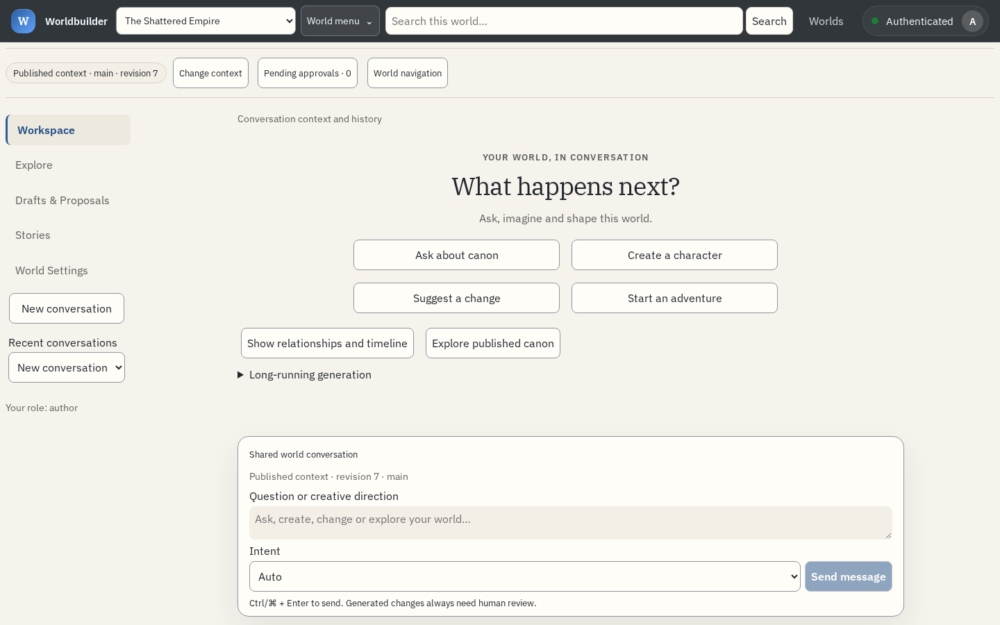
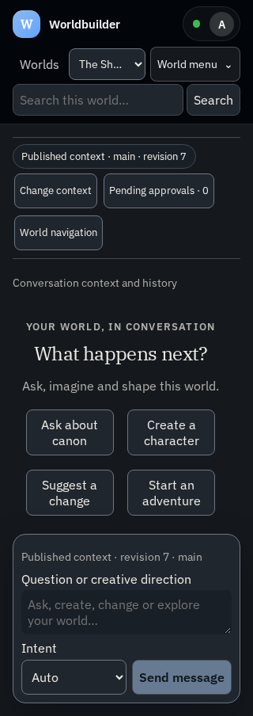

# Worldbuilder PWA responsive screenshots

Captured from the production Vite bundle in desktop Chromium on 19 October 2026.
The loopback API uses fictional fixture data; these are not deployed or real Android screenshots.
Each viewport passed document-width, composer-bounds and automated Axe WCAG A/AA checks.
Height is 900px; both themes request reduced motion.

| Width | Light | Dark |
| --- | --- | --- |
| 320px | [Light](worldbuilder-light-320.png) | [Dark](worldbuilder-dark-320.png) |
| 390px | [Light](worldbuilder-light-390.png) | [Dark](worldbuilder-dark-390.png) |
| 768px | [Light](worldbuilder-light-768.png) | [Dark](worldbuilder-dark-768.png) |
| 1024px | [Light](worldbuilder-light-1024.png) | [Dark](worldbuilder-dark-1024.png) |
| 1440px | [Light](worldbuilder-light-1440.png) | [Dark](worldbuilder-dark-1440.png) |

## Desktop preview

## Narrow preview

Automated checks do not establish installed-window behavior, a real software keyboard,
TalkBack or live-model answer quality. See [release gates](../../experience.md).
